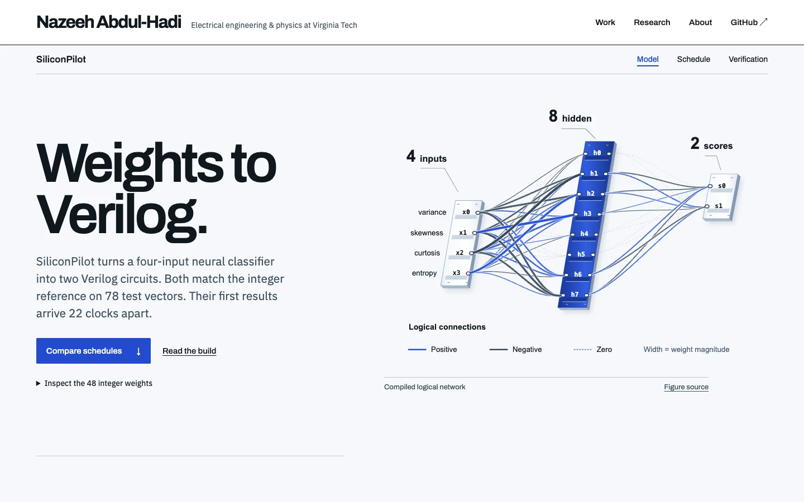

# Nazeeh Abdul-Hadi | Engineering portfolio

I study electrical engineering and physics at Virginia Tech. This portfolio collects my software, research and upstream contributions.

[Portfolio](https://nazeeh111.github.io/) · [Projects and case studies](https://nazeeh111.github.io/work/) · [Research library](https://nazeeh111.github.io/research/)

<picture>
  <source media="(max-width: 600px)" srcset="docs/presentation/portfolio-phone.webp">
  
</picture>

The opening case follows one neural classifier into two fixed-point Verilog circuits. Both matched the integer reference on the same 78 test vectors. Their first outputs arrived after 49 and 27 core clocks in RTL simulation. [Read the build](https://nazeeh111.github.io/work/siliconpilot/) · [Inspect the circuits](https://nazeeh111.github.io/SILICONPILOT/#schedule-case)

[Watch the 14-second walkthrough](https://nazeeh111.github.io/docs/presentation/portfolio-walkthrough.mp4) to see the two circuit schedules and open an editable bracket from the project index.

## Local preview

From the repository root, choose a fresh output directory.

```sh
python3 scripts/build-site.py --out /tmp/nazeeh-portfolio-preview
python3 -m http.server 8000 --bind 127.0.0.1 --directory /tmp/nazeeh-portfolio-preview
```

Open [the local preview](http://127.0.0.1:8000/). See the [maintenance guide](docs/MAINTAINING.md) for source catalogs, publishing checks and preserved routes, and the [figure provenance](assets/logic/PROVENANCE.md) for the opening case.
